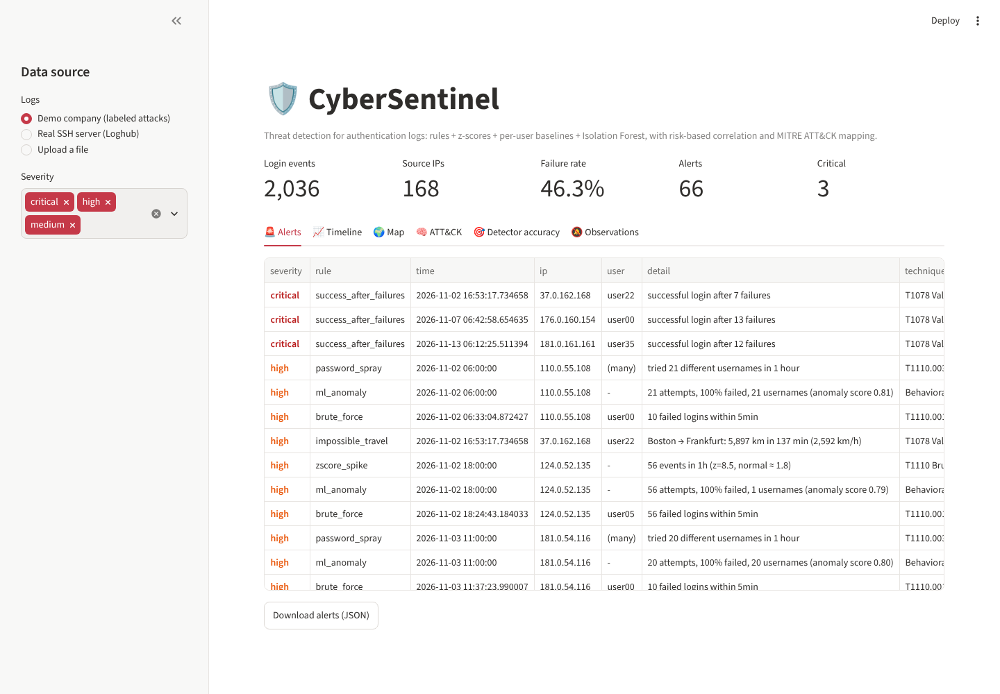
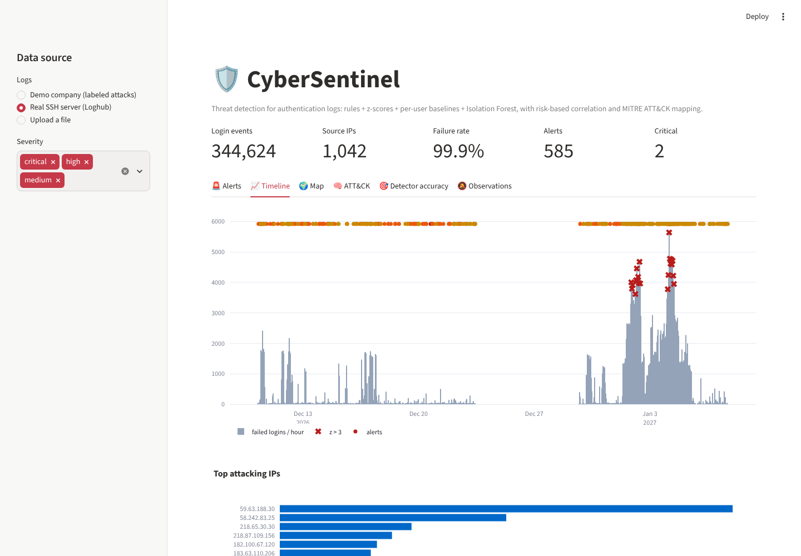

# CyberSentinel

[](https://github.com/HeyanshShah/cybersentinel/actions/workflows/tests.yml)

Threat detection for authentication logs. CyberSentinel layers **four detector families**:
rules, z-score statistics, per-user behavioral baselines, and an **Isolation Forest** ML
model. It then applies **risk-based correlation** to cut false alarms, maps every alert to
**MITRE ATT&CK**, and can **monitor logs live**. It was evaluated on labeled data and run
on **655,000 real SSH log lines**.



## Results

**Measured accuracy** (5 simulated organizations, 105 labeled attacks across 7 types; reproduce with `python -m sentinel evaluate`):

| Detector | Alerts/run | Precision | Recall | F1 |
|---|---|---|---|---|
| rules | 36 | 97.3% | 85.7% | 0.91 |
| statistical | 6 | 100.0% | 27.6% | 0.43 |
| baseline | 59 | 35.2% | 45.7% | 0.39 |
| ml | 20 | 95.6% | 57.1% | 0.71 |
| combined, no correlation | 121 | 66.9% | 97.1% | 0.79 |
| combined + risk correlation | 72 | 94.5% | 96.2% | 0.95 |

| Attack type | Detected | Recall |
|---|---|---|
| brute_force | 15/15 | 100% |
| password_spray | 15/15 | 100% |
| credential_stuffing | 15/15 | 100% |
| account_takeover | 15/15 | 100% |
| impossible_travel | 15/15 | 100% |
| low_and_slow | 15/15 | 100% |
| after_hours_abuse | 11/15 | 73% |

Risk correlation raised precision from 66.9% to **94.5%** while keeping recall at **96.2%**.
The hardest case is a malicious insider using valid credentials from their usual location.
Only the behavioral baseline can see that, so it catches 73% of them.

**Real-world run** on the [Loghub](https://github.com/logpai/loghub) OpenSSH dataset (an internet-facing server, about 1 month):
344,624 login attempts from 1,042 IPs, processed in about 4 seconds (~86k events/s). It flagged **99.1% of
heavy attackers** (210/212 IPs with ≥20 failures), and 2 critical "success after failures" logins for
an analyst to verify. Full write-up: [docs/REAL_DATA_RESULTS.md](docs/REAL_DATA_RESULTS.md).



## Detectors
| Detector | Type | Catches | ATT&CK |
|---|---|---|---|
| `brute_force` | rule | ≥10 failures from one IP in 5 min | T1110.001 |
| `low_and_slow` | rule | ≥30 failures/24h or ≥20 over 2+ days, under rate limits | T1110.001 |
| `password_spray` | rule | one IP trying ≥8 usernames/hour or ≥20/day | T1110.003 |
| `credential_stuffing` | rule | 15+ "quiet" IPs (≤3 attempts each) hitting 10+ accounts in an hour | T1110.004 |
| `success_after_failures` | rule | a success right after ≥5 failures: likely compromise (**critical**) | T1078 |
| `impossible_travel` | rule + geo | same account in two places faster than 900 km/h (haversine distance) | T1078 |
| `new_country` | rule | first login from a new country after an established history | T1078 |
| `unusual_hour` | per-user baseline | logins at hours *this user* almost never works (smoothed hour-of-day profile) | T1078 |
| `zscore_spike` | statistical | IP-hour activity > 3σ above normal | T1110 |
| `ml_anomaly` | Isolation Forest | unusual IP-hour feature vectors (attempts, fail ratio, usernames, night, new IP) | — |

**Risk-based correlation:** low-severity signals become alerts only when independent evidence on the
same account adds up within 24 hours. Otherwise they're kept as observations, which prevents alert fatigue.

## Live monitoring
```bash
python -m sentinel watch /var/log/auth.log     # tail -f style, alerts within seconds
```
Handles log rotation, keeps a sliding 24-hour window, prints each alert once, and sends serious alerts to Slack with `--slack`.

## Supported log formats
Linux `auth.log`/`secure` (OpenSSH, including syslog "message repeated N times"), Windows Security
events (4624/4625 CSV export), Cowrie honeypot JSON, and generic CSV.

## Tech stack
Python · pandas · NumPy · scikit-learn (Isolation Forest) · Plotly · Matplotlib · Streamlit · pytest · GitHub Actions

## Run it
```bash
pip install -r requirements.txt
python -m sentinel generate                      # labeled demo logs
python -m sentinel analyze sample_data/login_logs.csv --plot report.png
python -m sentinel evaluate                      # precision / recall / F1
bash scripts/download_real_data.sh               # 655k real SSH log lines
python -m sentinel analyze data/SSH.log
streamlit run dashboard.py                       # SOC dashboard
```
The CLI exits with code 1 on a critical alert, so it can gate cron jobs or CI.

## Tests
`pytest` runs 21 tests: every rule, the baseline, ML, correlation, all 4 parsers, the live monitor,
and an **accuracy floor** (precision ≥ 85%, recall ≥ 90%) that fails the build if detection regresses.
GitHub Actions runs them on every push and posts the accuracy table to the run summary.

## Layout
```
sentinel/parser.py     log formats -> one event table
sentinel/rules.py      7 rule detectors
sentinel/baseline.py   per-user hour-of-day profiles
sentinel/stats.py      z-score anomalies
sentinel/ml.py         Isolation Forest features + model
sentinel/correlate.py  risk-based alerting
sentinel/mitre.py      ATT&CK mapping
sentinel/geo.py        city coordinates, haversine
sentinel/stream.py     live monitoring
sentinel/evaluate.py   precision / recall / F1 harness
sentinel/generate.py   labeled attack simulator
dashboard.py           Streamlit SOC dashboard
```
