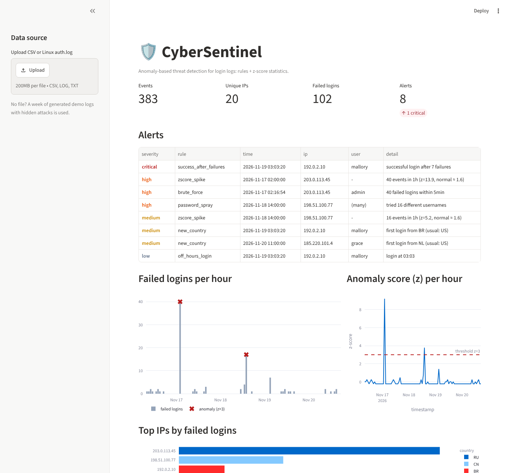

# CyberSentinel

Anomaly-based threat detection for login and server logs. Combines **rule-based
detection** for known attack patterns with **statistical (z-score) anomaly detection**
for unusual activity no rule was written for, and shows results in an interactive
Plotly dashboard.



## Detects
| Detector | Type | What it catches |
|---|---|---|
| `brute_force` | rule | ≥10 failed logins from one IP within 5 minutes |
| `password_spray` | rule | one IP trying ≥8 different usernames |
| `success_after_failures` | rule | a successful login right after ≥5 failures (possible break-in) |
| `new_country` | rule | a user logging in from a country they've never used |
| `off_hours_login` | rule | successful logins between 12am and 5am |
| `zscore_spike` | statistical | IP activity more than 3 standard deviations above normal |

Alerts are ranked by severity (critical → low), de-duplicated per rule/IP/user/hour,
exported to JSON, and optionally sent to **Slack** via webhook.

## Tech stack
Python · pandas · NumPy · Plotly · Matplotlib · Streamlit · regex log parsing · pytest

## Run it
```bash
python -m venv .venv
# Windows: .venv\Scripts\activate     Mac/Linux: source .venv/bin/activate
pip install -r requirements.txt

python -m sentinel.generate                     # create demo logs with hidden attacks
python -m sentinel sample_data/login_logs.csv   # command-line report
python -m sentinel sample_data/auth.log         # real Linux SSH log format
python -m sentinel sample_data/login_logs.csv --plot report.png  # Matplotlib PNG
streamlit run dashboard.py                      # interactive dashboard
```
Slack alerts: set `SLACK_WEBHOOK_URL`, then add `--slack`.
The CLI exits with code 1 when a critical alert is found, so it can run from cron/CI.

## Tests
```bash
pytest
```
Includes an end-to-end test confirming all 4 injected attacks are detected with no
alerts on normal users.

## Project layout
```
sentinel/parser.py    CSV + Linux auth.log parsing (regex)
sentinel/rules.py     rule-based detectors
sentinel/stats.py     hourly aggregation + z-score anomaly detection
sentinel/alerts.py    Alert model, severity ranking, dedupe, Slack webhook
sentinel/detect.py    runs every detector
sentinel/report.py    Matplotlib PNG report
sentinel/generate.py  synthetic log generator with injected attacks
sentinel/__main__.py  command-line interface
dashboard.py          Streamlit + Plotly dashboard
```
