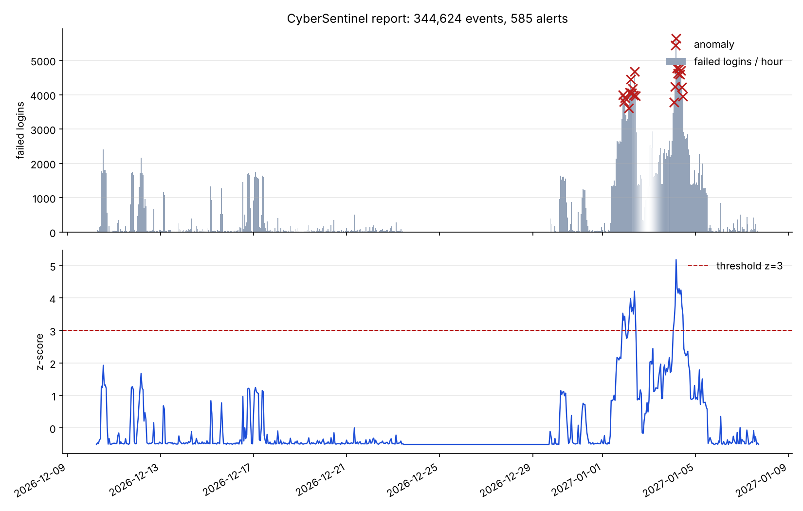

# Real-world results: Loghub OpenSSH dataset

CyberSentinel was run on **655,147 real log lines** from an internet-facing SSH server (Loghub `SSH.log`, ~1 month). No labels exist for real traffic, so these are observations, not precision/recall.

| Metric | Value |
|---|---|
| Login events parsed | 344,624 |
| Failed logins | 344,442 (99.9%) |
| Successful logins | 182 |
| Distinct source IPs | 1,042 |
| Distinct usernames tried | 1,751 |
| Processing time | 4.0 s (86,487 events/s) |
| Alerts raised | 585 (+10 low-risk observations suppressed) |
| Attacker IPs flagged | 256 |
| Coverage of heavy attackers (≥20 failures) | 99.1% (210/212) |
| IPs with both failures and a success, flagged | 3 |

## Alerts by MITRE ATT&CK technique

| Technique | Alerts |
|---|---|
| T1110.001 Brute Force: Password Guessing | 247 |
| T1110 Brute Force (statistical anomaly) | 164 |
| T1110.003 Brute Force: Password Spraying | 93 |
| Behavioral anomaly (needs triage) | 75 |
| T1078 Valid Accounts | 5 |
| T1110.004 Brute Force: Credential Stuffing | 1 |

## Top 10 attacking IPs by failed logins

| IP | Failed logins | Usernames tried |
|---|---|---|
| 59.63.188.30 | 86,294 | 1 |
| 58.242.83.25 | 43,147 | 1 |
| 218.65.30.30 | 25,102 | 1 |
| 218.87.109.156 | 21,377 | 1 |
| 182.100.67.120 | 18,513 | 1 |
| 183.63.110.206 | 17,340 | 1 |
| 183.238.178.195 | 14,519 | 1 |
| 139.219.191.138 | 10,852 | 51 |
| 183.62.140.253 | 10,852 | 51 |
| 182.100.67.52 | 10,198 | 1 |

## Most-guessed usernames

| Username | Attempts |
|---|---|
| `root` | 323,827 |
| `admin` | 8,073 |
| `test` | 543 |
| `oracle` | 489 |
| `support` | 486 |
| `user` | 369 |
| `pi` | 352 |
| `nagios` | 296 |
| `guest` | 259 |
| `postgres` | 216 |

Syslog omits the year, so timestamps are shown with a placeholder year.
